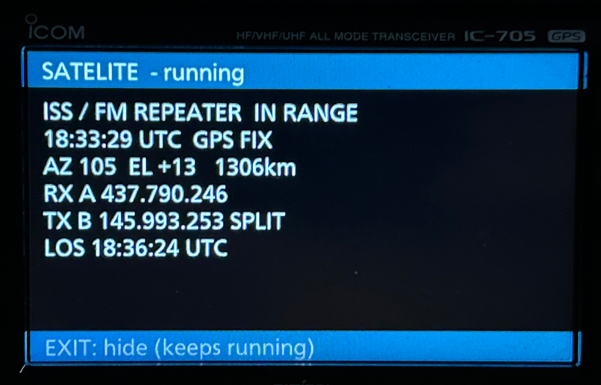

# SAT for IC-705

## Current development status — 2026-11-21

| Capability | Status |
|---|---|
| Standalone ISS GPS/Doppler tracking and STOP restoration | Existing v8 target; see hardware/software validation notes below |
| Startup TLE-age check and AOS/LOS search | Integrated; owner reports ISS tracking working; see validation limits below |
| Internet TLE retrieval | Both DNS and numeric-IP probes downloaded fresh ISS TLE on the radio; 0.18.0 integrates startup refresh and recoverable SD storage |
| Tracker radio control on v14 | Not yet supported/validated; v14 probe compatibility does not imply tracker compatibility |
| Native ISS detail popup | Native text dialog appeared on the radio; `DISPCHK.app` now reserves space for CLOSE; snapshot only |
| Text below the main frequency | Native status is integrated; 0.21.0 removes debug pauses that exceeded the v8 STOP deadline. Combined hardware verification pending. |
| Live graphical compass / production display integration | Dedicated UI-thread bridge still required; not implemented |

**Correction:** an earlier development note said v8 exposed no network API. It does: our original header omitted the extended entries. See [network research, test procedure and native display findings](docs/NETWORK-AND-DISPLAY.md).


A standalone **ISS FM cross-band repeater tracker**, displayed as `SAT`, that runs on the Icom IC-705 as an ICAP application from its microSD card. It uses the radio's internal GPS, calculates the ISS position and Doppler correction, and controls VFO A/B through the radio's native CI-V processing.

**Alternative firmware is required. Stock Icom firmware cannot run this application.** This release targets **SQ6EMM `705E140_20261119v8`**, ICAP ABI 3 / build `0x07051405`. Other SQ6EMM versions, including newer releases, are not automatically compatible.

This repository contains the application and its source. It does **not** contain Icom firmware, firmware patches, decoded radio images, manuals, or the separate experimental native-screen firmware.

## What it does

- Tracks **ISS only**, using SGP4, validated SD elements and startup HTTPS refresh.
- Reads a live fix from the IC-705's **internal GPS**; no manually entered location is used.
- Displays UTC, azimuth, elevation, slant range, corrected RX/TX frequencies, and an English waiting/pass countdown status.
- Configures **VFO A for downlink reception**, **VFO B for uplink transmission**, FM on both VFOs, **67.0 Hz CTCSS** on the uplink, and **SPLIT**.
- Applies Doppler correction during reception and updates the uplink while the operator transmits.
- Captures the pre-session VFO settings and restores them after **STOP**, with readback checks.
- Never presses PTT or starts a transmission. The operator controls PTT.

| ISS repeater profile | Nominal value |
|---|---:|
| Downlink / RX A | 437.800 MHz FM |
| Uplink / TX B | 145.990 MHz FM |
| Uplink CTCSS | 67.0 Hz |

Check [ARISS station status](https://www.ariss.org/current-status-of-iss-stations.html) before operating. An ISS position above your horizon does not establish that the repeater is currently available.

## Screen preview



**Actual IC-705 display photographed during an ISS pass.** The photograph shows an earlier build named `SATELITE`; the current application is named `SAT` and is loaded from `SAT.app`. No observer coordinates are shown. Displayed times and frequencies describe that photographed pass, not current conditions.

| Display item | Meaning |
|---|---|
| `SAT - running` | Application name and running state in the Apps window. |
| `ISS / FM REPEATER BELOW` | `BELOW` means the calculated ISS position is below the geometric horizon; the photograph shows `IN RANGE`, meaning elevation is at least 0°. |
| UTC / `GPS FIX` | Radio time and a valid internal GPS position. Set the radio clock to UTC. |
| `AZ`, `EL`, distance | Azimuth clockwise from north, elevation above/below the horizon, and slant range in kilometres. |
| `RX A`, `TX B`, `SPLIT` | Doppler-corrected frequencies used by the tracker. At startup they can be computed targets; after control/readback they are the last confirmed values. |
| Waiting / pass status (0.19.0) | `Waiting for ISS 21.11. 12:48` uses UTC. During a pass, `ISS pass: 7 min left` counts down to estimated LOS, rounding up. The photo shows the older AOS/LOS row. |
| EXIT footer | Hides the application window; **it does not stop tracking**. |

See [screen and operation details](docs/OPERATION.md). The normal `FM` label remains. Version 0.20.0 also scrolls waiting/pass status in the native receiver-status field below the frequency; this is separate from the DECODE/scope area.

## Requirements and firmware compatibility

| Requirement | Supported target |
|---|---|
| Radio | Icom IC-705, E firmware family |
| Firmware base | Icom `705E140`, with **SQ6EMM `20261119v8`** |
| Loader interface | ICAP ABI 3, build `0x07051405` |
| Position | Internal GPS with a live fix |
| Time | Correct radio date/time in UTC |
| Start context | VFO A or B; **DUP+ / DUP− disabled** |
| Orbit data | Valid ISS elements, NORAD **25544**, in `SAT.TLE` |

Upstream: [SQ6EMM custom firmware](https://github.com/sq6emm/icom-custom-firmware), [the version-specific v8 patch](https://github.com/sq6emm/icom-custom-firmware/blob/main/patches/705E140_20261119v8.json).

Installing alternative radio firmware is a separate operation with a risk of making the radio unusable. Follow the upstream backup/recovery instructions and use your own official Icom firmware file. **Do not substitute the latest upstream version just because it has Apps support.** This application's native bindings are version-specific; its checks are not a guarantee against every incompatible image.

## Install the application

If the supported alternative firmware is already installed, **no firmware update is needed for this application**.

1. Download [`SAT.app`](sd-card/IC-705/Apps/SAT.app?raw=true) and [`SAT.CFG`](sd-card/IC-705/Apps/SAT.CFG?raw=true), or clone this repository.
2. Create a fresh `SAT.TLE` as described below.
3. With the tracker stopped and the card removed from the radio, place these files on the card:

   ```text
   IC-705/
     Apps/
       SAT.app
       SAT.CFG
       SAT.TLE
   ```

4. Back up old tracker files outside the active `Apps` folder. Keep only one tracker executable; do not run old `SATELITE.app` and `SAT.app` together.
5. Safely eject the card, insert it into the powered-off radio, and start the radio.
6. Open **MENU → SET → Apps → SAT.app**. The window is named **SAT**.

`SAT.CFG` is currently a reserved placeholder. This release does not read settings from it. The application reads `SAT.TLE`; renaming an old TLE file without updating its elements does not make it current.

On macOS, `._*` AppleDouble sidecar files can confuse the older Apps loader. Remove only those sidecars from the card's Apps directory, keep its application count within the loader limit, and eject the card properly. The file extension may appear uppercase in the radio's FAT filename listing.

## Create and update SAT.TLE

TLE means **Two-Line Element set**: orbital data with an epoch and checksums, not your station coordinates. **Download real elements; do not invent the numbers or derive them from GPS.**

With Python 3.9 or later:

```sh
python3 tools/update_tle.py
```

The tool requests NORAD 25544 from CelesTrak, falls back to AMSAT if necessary, validates the pair, and writes `sd-card/IC-705/Apps/SAT.TLE`. It reports the source, epoch and age. A failed download or invalid response leaves an existing output file intact.

To write directly to a mounted card, use its actual mount path, for example on macOS:

```sh
python3 tools/update_tle.py --output "/Volumes/NO NAME/IC-705/Apps/SAT.TLE"
```

For an already downloaded multi-satellite TLE text file:

```sh
python3 tools/update_tle.py --input downloaded-elements.txt --output SAT.TLE
```

**Recommended workflow:** update before an operating session and aim for elements whose **epoch is less than 24 hours old**. Refresh before the next pass after known ISS manoeuvres or if predictions look inconsistent. This is an operational recommendation, not a guaranteed accuracy threshold. Daily refresh does not mean frequent polling of the data service is needed.

The application pauses control when the absolute difference between its radio UTC and the TLE epoch exceeds **7 days**. That is a rejection limit, **not** a recommendation to use week-old ISS elements. Restart the stopped application after replacing `SAT.TLE`; this release loads it at startup.

[Detailed TLE instructions, manual creation and troubleshooting](docs/TLE.md).

## STOP and restoration

Use **STOP in the Apps menu**, release PTT, and wait for the application to finish. EXIT only hides the window.

The tracker restores the captured A/B frequencies, modes/data/filter selections, CTCSS frequency and enable state, tone-squelch state, simplex operation, original VFO selection and SPLIT. It verifies readbacks. If it cannot complete restoration, it reports an error rather than claiming success.

The snapshot is kept in RAM for the current session. It is not a power-loss backup. Do not remove the battery/card or cut power while restoration is still running.

## Status and limitations

- The project is experimental and is not Icom software or endorsed by Icom or SQ6EMM.
- Hardware feedback confirmed GPS reception, RX correction cycles, software-confirmed uplink changes during operator-controlled TX, and successful restoration after STOP in the predecessor build.
- Version **0.15.0** renames that standalone application and its files to ISS. The four radio-control object files were byte-identical to the predecessor when checked locally; the renamed build still needs its own device confirmation.
- Software readback is not an independent measurement of the transmitted RF frequency.
- Manual tuning/mode changes can stop automatic control. Use STOP and start a fresh session to resume.
- There is no satellite selection, multi-satellite pass list, Doppler toggle, native SAT/DECODE panel, or automatic PTT. Native display probes are separate from the tracker.
- AOS/LOS searching uses a 30-second sampling step and is an estimate, not a second-accurate prediction.

See [validation scope](docs/VALIDATION.md) and [changelog](CHANGELOG.md).

## Build from source

```sh
python3 -m venv .venv
source .venv/bin/activate
python -m pip install -r requirements.txt
python tools/build.py
```

The output is `build/SAT.app`. Building does not require, fetch, or modify an Icom firmware file and does not access a radio. See [build details](docs/BUILDING.md).

## Credits and licensing

- ICAP runtime/alternative firmware and reverse-engineering reference: [Dawid SQ6EMM](https://github.com/sq6emm/icom-custom-firmware).
- SGP4 C implementation: [aholinch/sgp4](https://github.com/aholinch/sgp4), pinned in [SOURCE.txt](vendor/sgp4/SOURCE.txt), under the Unlicense.
- Project-authored application/tooling/documentation: [MIT](LICENSE). See [third-party notices](THIRD_PARTY_NOTICES.md) for vendored code and linked toolchain runtime notices.

Icom firmware and manuals are not licensed or distributed by this repository. Icom and IC-705 are names/trademarks of their respective owner.

## Startup sequence (0.18.0)

Startup checks radio UTC and the epochs in `SAT.TLE`, `SAT.BAK` (older versions also read legacy `SATELITE.TLE`). It selects the usable candidate closest to radio UTC. If none is usable, or the selected elements are more than 24 hours from UTC, it tries a hostname-based HTTPS update. Valid elements already within 24 hours skip the network request.

Downloaded elements must pass checksums, NORAD identity, orbit initialization and a 24-hour epoch limit. The app saves them into the alternate `SAT.TLE` / `SAT.BAK` slot and verifies the bytes by reopening it. The selected valid file is never opened for writing. There is no rename/fsync API, so this is a recoverable two-slot cache, not a claim of atomic FAT updates or immunity to card/power failure. If saving fails, verified downloaded data can still be used in RAM for that session.

When networking fails, a validated cached orbit within seven days can be used offline. If no usable orbit exists, no radio control starts. UTC changes or an expired cache pause control; restart to perform a new startup download attempt. Online checks run at startup only.

After loading TLE, the app waits for internal GPS and computes the next AOS/LOS before starting its existing radio-control session. STOP during startup cancels before radio settings are captured or changed. The integrated update/save path has host and simulated ARM validation; it still needs a device run. The separate DNS and numeric-IP HTTPS probes have both downloaded and validated a fresh ISS TLE on the owner's IC-705.

## Version 0.19.0

The Apps window now shows `Waiting for ISS DD.MM. HH:MM` (UTC) or `ISS pass: N min left`. Remaining minutes are rounded up; predictions still use 30-second horizon sampling. The next search restarts after horizon loss. Startup TLE refresh, Doppler control and original-setting restoration on STOP remain in SAT.app. This version tracks ISS only; CFG satellite selection and overlap priorities are deferred.

In 0.19.0, main-screen text was deliberately **not integrated**: the owner confirmed FRQTEXT text visibility but reported a radio freeze on FRQTEXT STOP. ISS STOP and OFF/ON were reported to work. That diagnostic was kept separate pending cleanup work; a simulated restoration is not evidence of safe hardware cleanup.

## Version 0.20.0 — satellites

The app is now `SAT.app`, displayed as `SAT`. Its card companions are `SAT.CFG` (still a placeholder), `SAT.TLE`, `SAT.BAK` (alternate validated cache), and `SAT.LOG` (last display-cleanup stage). Migration preserves the original ISS/FRQTEXT files outside Apps and copies usable existing elements to the renamed cache; this build reads only the new TLE names. Satellite selection is still ISS-only.

`Waiting for GPS`, `Waiting for ISS DD.MM. HH:MM` (UTC), and `ISS pass: N min left` appear in the Apps window. In normal FM/RX, the APRS-derived native field below the frequency scrolls the same message through its 13-character space, once per second. Publication pauses in TX/non-FM. No receive-packet/history injection or fake APRS messages are used.

The owner reports FRQTEXT test 6 no longer freezes on STOP. The cause is not established: diagnostic file writes and delays changed timing. This integration retains closed stage records and 750 ms cleanup pauses, restores owned display state, then restores original radio settings. Allow the complete STOP sequence to finish before power-off. Combined on-radio validation is still required.

## Version 0.21.0 — SAT and STOP deadline

Use `SAT.app`, displayed as `SAT`, with `SAT.CFG` (reserved), `SAT.TLE` and automatically managed `SAT.BAK`. This short name fits the radio's older filename listing. Old tracker executables and companion files are archived outside Apps during migration. The tracker still follows ISS only.

The owner reported `App killed (no stop)` with 0.20.0. Inspection of the pinned v8 loader shows a 3,000 ms STOP grace period; the six 750 ms diagnostic delays alone required 4,500 ms. Version 0.21.0 removes display-cleanup delays and SD log I/O, retains ownership-checked text-cache restoration and native redraw, and polls original radio-setting restoration every 10 ms instead of 50 ms. It also removes a three-second wait after restoration failure. Display cleanup no longer generates a LOG file. Wait for the app to exit and confirm original radio settings. Unresponsive CI-V or a held PTT can still prevent a successful restore; no forced queue reset or firmware timeout change is made.
