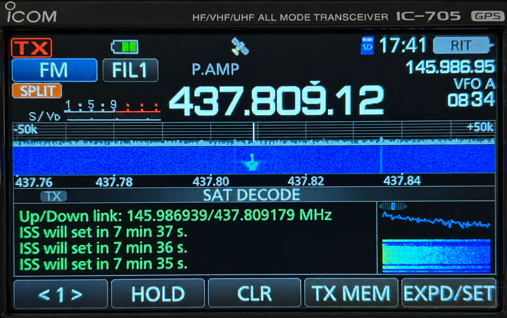

# SAT Tracker for Icom

Experimental FM satellite tracking directly on the **Icom IC-705**. Current release: **SAT 0.42-DECODE**, for **SQ6EMM firmware `20261119v14` on the IC-705 E (Icom 1.40 base)**. IC-9700 is not currently supported.

SAT uses internal GPS, refreshes orbital data over Wi-Fi, selects passes and applies RX/TX Doppler correction with VFO A/B, SPLIT and CTCSS. It includes **ISS, SO-50, AO-91, AO-123 and SO-131**; [configuration order](docs/CONFIG.md) sets priority for overlapping passes. **SAT never keys PTT.** Use STOP to end tracking and restore the saved radio settings.



*SAT 0.42 tracking ISS on the owner's IC-705 in FM, with the radio's spectrum above SAT DECODE. The text shows the remaining pass time and the combined Up/Down link line (uplink first). The TX indicator shows operator-controlled transmission, not automatic PTT from SAT.*

## Display

SAT now uses the radio's native **DECODE window**, through the ICAP interface.

Example output:

```text
Starting satellite tracking.
Waiting for SO-131 until 20:45 UTC.
Tracking ISS.
ISS will set in 9 min 59 s.
Azimuth: 278 deg. Elevation: +5 deg.
Distance: 1848 km.
Up/Down link: 145.986682/437.809949 MHz
```

Messages use natural English without the former `SAT:` prefix. **Up/Down link lists the uplink first and the downlink second**, in MHz. State changes are limited to one message per second; tracking details are added every five seconds. DECODE is a scrolling history, not a fixed dashboard: existing lines are not overwritten. During TX the firmware may defer display updates, and its bounded queue can drop messages. The small spectrum and waterfall on the right are the radio's native audio display, not a satellite path plot.

## Installation

1. Requires the **full SQ6EMM `705E140_20261119v14` firmware** and its matching `ICAPCOLD.BIN` and `ICAPSPOT.BIN` files in `IC-705/Apps/`. Obtain them from the [SQ6EMM firmware project](https://github.com/sq6emm/icom-custom-firmware). Stock Icom firmware, v8 and the earlier experimental MIN builds are not targets of this release. Firmware and runtime files are not distributed here.
2. Back up your existing SAT application. Copy [SAT.app](sd-card/IC-705/Apps/SAT.app?raw=true) to `IC-705/Apps/` on the microSD card. The filename is case-insensitive on the radio's FAT card; **keep only one copy of SAT**. Check the [SHA-256 sums](sd-card/SHA256SUMS.txt).
3. For a first installation, also copy [SAT.CFG](sd-card/IC-705/Apps/SAT.CFG?raw=true). When upgrading, **keep your existing SAT.CFG, SAT.TLE and SAT.BAK**. See [configuration](docs/CONFIG.md) and [orbital data updates](docs/TLE.md).
4. Set the radio clock to **UTC**, enable internal GPS and connect Wi-Fi if orbital data needs updating.

## Start and stop

1. In the mode selector, press **RTTY** repeatedly to select the registered **SAT** decoder (RTTY → RTTY-R → SAT, if SAT is the only installed decoder).
2. Select **FM** again. The **SAT DECODE** window is used for tracking output; the app's eight-line panel remains available through **MENU → SET → Apps**.
3. Use the app's **STOP** action to finish tracking and restore its saved settings. Wait for completion before switching off. Do not assume that hiding a window has stopped the background app.

STOP reports its progress separately:

```text
Stopping satellite tracking.
Restoring the original radio settings.
Original settings restored.
Tracking has stopped.
```

`Original settings restored.` is emitted only after a successful restoration result. Failure or an unfinished restoration instead reports `Radio settings could not be restored.` Merely seeing a stop request is not confirmation that settings were restored.

Starting SAT directly from Apps without selecting its decoder currently shows a prompt. **Automatic activation of SAT DECODE from an arbitrary mode is not implemented.** Also, the saved settings are those present when SAT captures them: switching through RTTY before starting can change the mode that STOP later restores.

If the radio is transmitting, release PTT before initial setup, satellite switching or restoration. SAT does not transmit an activation carrier or start a transmission on its own.

## Status and limitations

The screenshot confirms the new SAT 0.42 messages and combined frequency line in the SAT DECODE display on an IC-705 in FM. Version 0.42 passed 49 host tests and targeted ARM checks against v14, including its loader, DECODE queue with the combined frequency line, GPS bindings and initial CI-V publication. These do not constitute a complete on-radio validation of every tracking, TX and STOP/restore path.

Passes are geometric predictions; repeater availability and operating restrictions are not inferred from TLE data. Review the satellite notes in [configuration](docs/CONFIG.md) before use.

**Work in progress. Experimental software — use entirely at your own risk. No warranty is provided.**

The DECODE-window approach was inspired by [EA5JLJ's SKIM](https://github.com/ea5jlj/skim-ic705). ICAP and the custom firmware are by [Dawid SQ6EMM](https://github.com/sq6emm/icom-custom-firmware).

[Configuration](docs/CONFIG.md) · [TLE updates](docs/TLE.md) · [Third-party notices](THIRD_PARTY_NOTICES.md) · [Checksums](sd-card/SHA256SUMS.txt)
