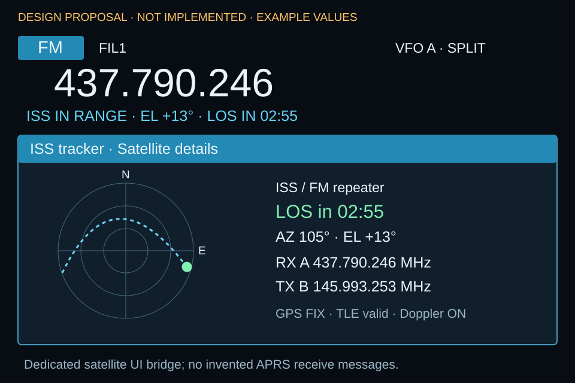

# Network and main-screen integration research

Status: 2026-11-21. This is a development report, not a claim of device validation.

## What has changed

Our previous statement that firmware v8 had no networking API was incorrect. The app's local `Api` declaration stopped at offset 0x50; reverse engineering the **extended** table in v8 and v14 found network callbacks beyond that boundary. No firmware update is inherently required just to investigate networking on v8.

The tracker remains targeted at v8. The separate experimental **TLEDNS.app / TLEIP.app** recognises the network function table of v8 and v14. That does not make the tracker radio-control bindings v14-compatible.

## Pinned evidence

Upstream repository: [SQ6EMM custom firmware](https://github.com/sq6emm/icom-custom-firmware/tree/d890902db03ea716e92848fe8b3c173d71a18e25).

- v14 patch: `patches/705E140_20261119v14.json`; decoded main MD5 `290c76af32ecc54c23aa0b9a0aa797a3`.
- v8 decoded main MD5 `13b956a2b958be7ccfa51f4011584616`.
- Both reconstructed from the owner's original Icom image; neither proprietary image is distributed here.
- The build identifier remains `0x07051405` in both versions; it alone cannot distinguish v8 from v14.

The reverse-engineered ARM32 table offsets are:

| Offset | Inferred callback | v8 function pointer | v14 function pointer |
|---|---|---|---|
| 0x6c | Network readiness, 0 when ready | 0x2037b551 | 0x2037b579 |
| 0x70 | Connect(host, port, flags, timeout_ms) | 0x2037c455 | 0x2037c601 |
| 0x74 | Send(handle, buffer, count, timeout_ms) | 0x2037bb29 | 0x2037bc21 |
| 0x78 | Receive(handle, buffer, count, timeout_ms) | 0x2037bc3d | 0x2037bd35 |
| 0x7c | Close(handle) | 0x2037b611 | 0x2037b639 |
| 0x80 | Last socket error | 0x2037b563 | 0x2037b58b |
| 0x84 | Native seven-line popup/menu | 0x2037c011 | 0x2037c101 |

Run `python3 tools/audit_network_table.py /path/to/privately-decoded-main.bin` to reproduce the read-only table checks.

Pointers are Thumb-tagged. `tle_network_supported()` checks the five readiness/transport pointers and the native-error callback plus radio/build/ABI/size before any network call. These are inferred internal interfaces, not an upstream public SDK contract.

In the v14 connect wrapper, flag bit 2 selects UDP (`type=2`, `protocol=17`). With bit 2 clear, flag bit 0 selects `type=1`, `protocol=100`, versus ordinary TCP protocol 6. The secure branch also configures socket option 0x2d with the hostname. We infer a TLS path from this, but **certificate validation and SNI semantics have not been independently verified; successful port-443 TLE retrieval is now reported on the radio**. The probe uses port 443 and flags 1; there is no plaintext HTTP fallback.

## Isolated HTTPS test

Build:

```sh
python3 tools/build.py --probe
```

The result is `build/network-probe/TLEDNS.app`; a matching prebuilt copy is in [`experimental/TLEDNS.app`](../experimental/TLEDNS.app). Copy it into the radio's Apps directory, keep the matching upstream firmware support files installed, connect the radio to a network with internet access, set the clock to UTC, and start the check through Apps. Stop the tracker and other apps first.

The check:

1. Verifies the supported extended function table and network readiness.
2. Tries CelesTrak over HTTPS, then AMSAT if the first attempt fails.
3. Parses bounded HTTP responses, including Content-Length, close-delimited and chunked bodies.
4. Requires one ISS 25544 line pair with correct lengths/checksums, validates the orbit through SGP4 and reports epoch offset against radio UTC.
5. Shows `PASS: ISS TLE <=24h` only after those checks succeed.
6. Closes every successfully opened handle before waiting for STOP.

**No frequency, mode, VFO, SPLIT or PTT commands are present in the probe. It does not write to the SD card and does not replace ISS.TLE.** Replacing the tracker with it is unnecessary: it is a separate diagnostic app.

The probe makes at most two requests per launch. Transport operations use finite timeouts and the application checks STOP between calls. Firmware DNS/TLS internals may have additional blocking behavior that cannot be bounded by these host tests. HTTP redirects, compression, chunk trailers, malformed or oversized input are rejected. This conservative probe can reject a legitimate server response; report the displayed error rather than weakening validation.

Device verification needed: firmware version, source hostname, final status/epoch offset, STOP response. A positive result verifies a software download, not TLS peer authentication. Do not treat network TLE checksum validation as a cryptographic authenticity guarantee.

## Main radio screen and APRS photographs

The supplied APRS photographs demonstrate native RX text under the frequency and a native position/detail dialog. Analysis of APRS.APP confirms it publishes into the original Icom receive-message path: an IC-705 E profile references a receive mailbox at `0x203e23c1`, pending flag `0x205d9dab` bit `0x40`, and receiver-state byte `0x203e212f`. It is not simply drawing arbitrary text through `Api.line()`.

Sending invented APRS/D-STAR receive messages to show satellite status could affect receive history, callsigns and native packet handling. The tracker does not do that. `Api.line()` still writes its Apps window. The seven-line popup at offset 0x84 is a separate native information-dialog helper; the original English text table contains “Failed to connect to the repeater.” followed by six empty lines. It is not the APRS compass/detail API, and is not invoked by the network probe. The separate [`DISPCHK.app`](../experimental/DISPCHK.app) tests this information dialog with computed ISS azimuth/elevation, range and a simple text direction marker. It reads GPS plus ISS.TLE or SATELITE.TLE and never writes native receive-message mailboxes. Close with BACK and use Apps STOP. It shows a single snapshot; a live graphic compass and text under the frequency are not implemented.



The image is a layout proposal, not a screenshot or an implemented feature. Its values are illustrative. The intended main-screen display is:

- A short SAT status under the frequency: ISS visibility, elevation and time to AOS/LOS.
- A separate detail view with azimuth/elevation, countdown, RX/TX frequencies and eventually a polar plot.
- Native FM radio operation and meter/scope behavior preserved.
- Explicit ownership and cleanup when the app stops or ceases updating; no fake received packets.

That requires a dedicated, verified firmware/UI bridge or a supported extension from upstream. The existing experimental native-panel firmware in the development workspace has **not** been installed or validated on v14 and is not included in this repository.

## Next integration gate

After a real-radio HTTPS result, integrate downloads into tracker startup with offline fallback, fresh-epoch validation and durable file replacement. Audit v14's radio-state callback and all existing GPS/CI-V/session bindings before enabling v14 tuning. The main-screen UI bridge is a separate task; neither feature is claimed complete by this probe.

## Device feedback and second diagnostic round

The operator reports `NET CONNECT FAILED` from the first HTTPS probe and confirms that the native ISS popup appeared; native CLOSE obscured its lower rows. The revised dialog uses only four information rows. DNS/IP checks and error capture are described in [the four-app procedure](../experimental/README.md).

A separate experimental v8-only FRQTEXT app now tests native drawing at x=12/y=96 without a firmware hook or RX-message injection. It uses the native text wrapper at 0x2037b88d and rectangle routine at 0x2014775c, gated by normal-screen visibility, FM and RX. It requests native UI redraw through the two existing UI dirty flags on STOP. This is an app-thread drawing experiment; it does not remove the need for a production UI-thread bridge and does not claim a stable overlay or graphic compass.

## Third round: confirmed downloads and integrated startup

The operator reported both hostname and numeric-IP checks succeeding on the IC-705: TCP C=0/E=0, CelesTrak TLS C=0/E=0, valid ISS elements with a +9-hour epoch offset. The reported connect times were 2,898 ms (hostname) and 7,157 ms (numeric IP). AMSAT was not attempted because CelesTrak succeeded. DNS failure is therefore not demonstrated by those tests. The shortened information dialog was also confirmed to fit above CLOSE.

Version 0.18.0 integrates hostname HTTPS retrieval into tracker startup when the cache is missing or older than 24 hours. See the operating/TLE notes for the two-slot ISS.TLE / ISS.BAK storage and offline behavior. The integrated SD write is not yet device-confirmed.

The first FRQTEXT computed a position in its own Apps window but showed no main-screen text. Its layer-18 draw target is the Apps surface. Native normal-radio text call sites use surface 12 (480x123); test 3 reproduces the native text argument layout on that surface at x=12/y=96. It remains an experimental direct app-task draw and may be overwritten by normal rendering. It now records UI state, mode, TX, MAIN/ELSE counts and DRAW attempts, plus the last draw state. Reopen its Apps window after checking the normal frequency screen to inspect those counters. Both v8/v14 UI bindings are pinned, without changing the tracker's v8-only control target.

## Fourth display test: APRS final UI cache

Per operator request, FRQTEXT now uses the final display-cache portion of the APRS path instead of app-thread GPU painting. Native `2004a208` copies formatted source text into the bank-zero cache at `20393020 + 2e`, stores its length at `+3b`, marks visibility/update fields and calls UI notification `200b8f14`. The probe updates only the text/length and relevant display bits, and uses the same original notification. It never publishes into packet mailbox `203e23c1` or pending flag `205d9dab`. The display fields are captured/restored on STOP only while the status remains owned.

The native update and notification signatures are checked. The native notification's observed writes are UI flags at `20380584`, `2038058c` and a redraw cursor at `203db21c`. ARM simulation executes that original notification and verifies allowed write addresses and STOP restoration. This is not a full native background-task simulation or proof of LCD/history behavior. Device feedback is still needed.

A separate formatter bug explained blank hexadecimal diagnostics: the minimal formatter did not implement `%X` and therefore failed to consume those arguments. The fix supports x/X and is tested with the actual formatter, including mixed hex/decimal argument ordering and output truncation. The old `R:112` must not be treated as a native return code.
