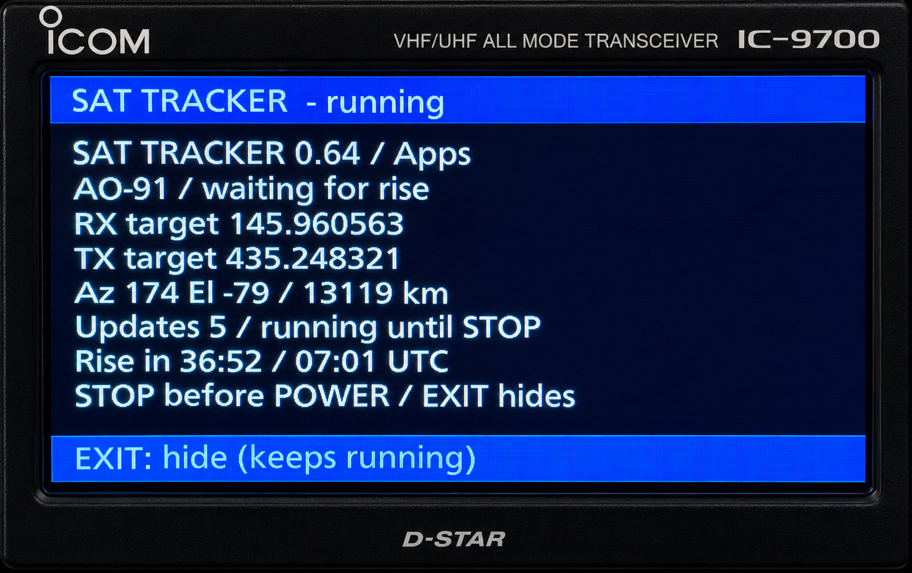

# IC-9700 — SAT TRACKER 0.66



Requires **IC-9700 E / Icom 1.50 base with SQ6EMM 9700E150_20261119v14**, including its matching ICAP runtime files. Obtain these from [SQ6EMM](https://github.com/sq6emm/icom-custom-firmware); they are not included here. This app is not for IC-705.

## Install

1. Back up your SD card. Download the whole repository (**Code → Download ZIP**) and extract it. With Python 3, run from its directory:

   ```sh
   python3 tools/install_9700.py /path/to/SD-card
   ```

   On macOS, for example: `python3 tools/install_9700.py /Volumes/IC9700`.
2. Edit **`IC-9700/Apps/SATPOS.CFG` on the card** with your own position in decimal degrees:

   ```ini
   latitude=50.000000
   longitude=14.000000
   ```

   These are example coordinates. North/east are positive; south/west negative. The app refuses the unedited placeholders.
3. Set the radio clock to **UTC** and connect LAN with working IP, gateway and DNS.

The installer preserves existing configuration, orbital data and TLS seed files, and backs up replaced app files. The one-time TLS setup needs the computer; downloads during operation run entirely on the radio.

## Use

1. Enable native **SAT / DUAL**, select **MAIN**, and select **VFO A on both sides**. Use the 144/430 MHz bands. Turn DATA, TONE/TSQL and DUP off on both sides. Start in RX.
2. Open **MENU → SET → Apps → SAT TRACKER**. It updates orbital data over LAN and then starts tracking automatically. The app selects FM/FIL1 and the configured tone.
3. The Apps panel shows the selected satellite, geometry, pass countdown and frequencies. EXIT hides the panel while tracking continues. There is no DECODE display in this version.
4. Use **STOP** before POWER OFF. Wait for restoration and check the original frequencies/modes. Direct POWER OFF while SAT runs is not yet supported reliably.

Downlink is on MAIN, uplink on SUB. Doppler correction also runs during operator-controlled TX; SAT never keys PTT. Satellite switching and settings changes wait for RX.

## Files

| File in `IC-9700/Apps/` | Purpose |
| --- | --- |
| `SAT.APP` | The single SAT TRACKER entry in Apps |
| `SATUPD.BIN`, `SATCORE.BIN` | Required app modules; keep both beside SAT.APP |
| `SAT.CFG` | Satellite profiles and priority |
| `SATPOS.CFG` | Your station position |
| `SATLIVE.CFG` | Run settings; leave the supplied default |
| `SATNET.S0`, `SATNET.S1` | Private TLS state, created/maintained locally; do not share |

Updates must replace **SAT.APP and both BIN modules together**. Keep your CFG, TLS state and orbital files. The former standalone `SATNET.APP` updater is no longer needed. SAT CHECK and other development tools are not required.

If LAN fails, valid saved data up to seven days old can be used. A first run without internet or saved data cannot track. On an update error, `SATNET.LOG` on the card helps identify the failure; do not share TLS seed files. If “Module missing/invalid” appears, reinstall the complete matching app set.

## Changes in 0.66

Only changed Apps rows are sent to the display runtime, including changes to countdowns, frequencies and geometry. Doppler tuning rates and radio-control behavior are unchanged. The existing screenshot above shows 0.64.

## Logs (since 0.65)

At startup, SAT preserves **three previous generations** before replacing the current logs. `1` is the newest archive and `3` the oldest; the oldest is replaced on the next start. There are 21 archive files, with at most about **17 kB of content** in total, plus SD filesystem allocation overhead.

| Current file | Previous generations |
| --- | --- |
| `SATNET.LOG` | `SNETL1.LOG` … `SNETL3.LOG` |
| `SATLIVE.LOG` | `SLIVE1.LOG` … `SLIVE3.LOG` |
| `SATEVENT.LOG` | `SEVNT1.LOG` … `SEVNT3.LOG` |
| `SATLV0.BIN`, `SATLV.TAG` | `SBASE1.BIN` … `SBASE3.BIN`, `STAGS1.BIN` … `STAGS3.BIN` |
| `SATERR.BIN`, `SATTX.LOG` | `SERRS1.BIN` … `SERRS3.BIN`, `STXLG1.LOG` … `STXLG3.LOG` |

These are short rolling logs, not a complete tuning history. Empty archive files mean the corresponding source was unavailable. Snapshots or error records can be older than the latest run; match their tags and baseline identifiers. If archiving reports an error, tracking does not start. Rotation is not atomic during a power interruption.

For a fault report, copy the current logs and archives before further restarts. Include the matching baseline/tag files if requested. **Never share `SATNET.S0` or `SATNET.S1`.** STOP deliberately avoids starting SD writes, so a missing final END line alone does not prove a crash.

Archive rotation was verified on the owner's radio. This update preserves evidence for diagnosing a freeze; it does not claim to fix its cause. Version 0.66 updates only changed Apps rows. The owner reports better menu responsiveness after a radio test, but this does not prove that all missed taps are resolved. Once STOP is accepted, wait for restoration before switching off.

[Configuration](../../docs/CONFIG.md) · [Orbital updates](../../docs/TLE.md) · [Back](../../README.md)
